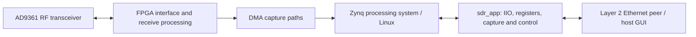

# SDR Spectrum Analyzer

FPGA and embedded Linux software for the **PUZHI PZSDR P201PRO** board with a
**Zynq-7020** and **AD9361** RF transceiver.

[راهنمای فارسی](README.fa.md)

The project was originally developed on Ubuntu 18.04 using Vivado 2019.2 and
PetaLinux 2019.2. This repository brings the hardware design and current embedded
application together, with the ADI HDL needed by the hardware stored locally.

## Components and status

| Component | Location | Status |
| --- | --- | --- |
| FPGA design and local IP repositories | [P201Pro](P201Pro/README.md) | Bitstream generation confirmed by the project owner in Ubuntu / Vivado 2019.2 |
| Embedded C++ control and capture application | [sdr_app](sdr_app/README.md) | Current working sources imported, including WAVE capture and SINAD commands |
| PetaLinux project | [zynq_sdrBo](zynq_sdrBo/README.md) | Source inputs and preparation scripts ready; new image build and board boot pending |
| Host GUI / receiver | External | Not included in this repository |

Bitstream generation was reported successful on **2026-11-09**. This confirms
hardware project generation through bitstream output; it does not establish a
new timing report or an end-to-end RF / Linux runtime test for this import.
The application sources have not been rebuilt on the target during this import.

## System overview



The application controls AD9361 through libiio, accesses FPGA registers and DMA
through Linux device interfaces, and sends or receives the project's custom
Layer 2 frames. Its current audio code also supports timed WAVE recording and
a SINAD measurement intended for a modulation tone near 1 kHz.

## Repository layout

```text
P201Pro/
  create_project.tcl        Recreate the current Z7020 hardware project
  system_bd.tcl            Import the authoritative block design
  pzp351.srcs/              Required BD, wrapper and coefficient inputs
  ip_repo/                  Project-specific packaged IP sources
  third_party/adi_hdl/      Required ADI IPs, interfaces and license files
  scripts/                  Static checks and Vivado validation
  tests/                    Portability regression checks
sdr_app/
  src/                      Current C++ implementation
  include/                  Register, DMA, RF and protocol interfaces
  third_party/libiio/       Supplied ARM library, header and license files
  bin/deploy.sh             Deployment helper
  docs/                     Service helper, protocol notes and captures
zynq_sdrBo/
  project-spec/             PetaLinux configuration and custom user layer
  hardware/                 Original XSA snapshot
  dependencies.lock.json    Locked ADI source revisions
  scripts/                  Separate workspace preparation and checks
```

Earlier repository revisions kept the application at the root. It now lives in
`sdr_app/`; run its build and deployment commands from that directory. The prior
history is retained.

## Build the hardware

Use Ubuntu 18.04 and **Vivado 2019.2**, with Zynq-7000 device support installed.
Load your Vivado installation's `settings64.sh`, then:

```bash
git clone https://github.com/ramin-chegini/sdr-spectrum-analyzer.git
cd sdr-spectrum-analyzer/P201Pro
python3 scripts/check_adi_vendor.py
python3 -m unittest discover -s tests -v
vivado -mode batch -source create_project.tcl \
  -tclargs --output_dir build/full_build --build --jobs 4
```

The output directory must be empty or new. The resulting project is
`build/full_build/pzp351.xpr`, and the bitstream is normally
`build/full_build/pzp351.runs/impl_1/system_top.bit`.
The build uses the checked-in ADI subset; no sibling ADI checkout, submodule,
download, or `ADI_HDL_DIR` variable is required. Keep the existing IP versions.
See the [hardware guide](P201Pro/README.md) for GUI use and validation commands.

## Build and run the application

The Makefile targets Linux ARM hard-float using `arm-linux-gnueabihf-g++` and
C++17. From an Ubuntu environment with that compiler and GNU Make installed:

```bash
cd sdr-spectrum-analyzer/sdr_app
make
```

The output is `sdr_app/bin/sdr_app`. Run it on the Zynq Linux target, with a
compatible FPGA image, device tree, AD9361 IIO devices, DMA mappings and libiio
runtime. It is not a Windows or desktop x86 executable.

```bash
# Commands below run on the board after installing the executable.
sdr_app --help
sdr_app ad9361 status
sdr_app status
```

The default network interface is `eth0`; choose `eth0` or `usb0` in
`sdr_app/include/network_config.h` before building. Device access and raw Ethernet
operations require the corresponding permissions, typically root on the target.
See the [application guide](sdr_app/README.md) for deployment, audio commands,
register addresses and packet formats.

## Prepare the Linux workspace

The [PetaLinux guide](zynq_sdrBo/README.md) and
[Persian instructions](zynq_sdrBo/README.fa.md) describe recreating the original
PetaLinux 2019.2 inputs in a separate Ubuntu workspace. The preparation script
checks out pinned ADI dependencies, imports an explicitly selected XSA, preserves
custom configuration/DTS inputs and stages the current application for compilation
by its BitBake recipe. Standard Yocto downloads/caches are still needed.

```bash
python3 zynq_sdrBo/scripts/check_project.py
python3 -m unittest discover -s zynq_sdrBo/tests -v
```

Preparation/staging tests pass locally. The new PetaLinux image build, matching
hardware handoff and board boot still need validation on Ubuntu 18.04; a Linux
image result is not implied by the earlier FPGA bitstream result.

## Third-party code

ADI HDL sources retain their original notices and license files under
`P201Pro/third_party/adi_hdl`. The supplied libiio 0.21 files and licenses are under
`sdr_app/third_party/libiio`. These dependency licenses do not designate a license
for all original project code; a repository-wide license has not been selected.
